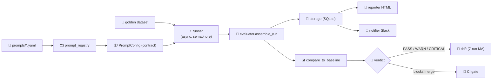

<div align="center">

# 🚦 MRDS — Model Regression Detection System

### *Watches your LLM feature. Catches regressions before your users do.*

[](https://github.com/space-rock-0/llm-regression-gate/actions/workflows/eval.yml)
[](https://github.com/space-rock-0/llm-regression-gate)
[](https://space-rock-0.github.io/llm-regression-gate/)
[](https://space-rock-0.github.io/llm-regression-gate/MRDS-api-docs.html)
[](https://youtu.be/HT8WEmzrK34)
[](https://www.python.org/)

**📖 [Interactive Blog](https://space-rock-0.github.io/llm-regression-gate/) · 🔧 [API Docs](https://space-rock-0.github.io/llm-regression-gate/MRDS-api-docs.html) · 🎬 [Demo Video](https://youtu.be/HT8WEmzrK34) · 📊 [Slide Deck](https://space-rock-0.github.io/llm-regression-gate/MRDS-showcase.html)**

<br>

[](https://youtu.be/HT8WEmzrK34)

</div>

---

## ✨ What is MRDS?

MRDS watches an LLM feature over time and alerts you when it gets worse. It runs a versioned prompt against a human-labelled golden set, scores exact match / summary quality / latency / tokens, diffs the result against a stored baseline, and returns a verdict:

| Verdict | Meaning | CI Result |
|:-------:|---------|:---------:|
| ✅ **PASS** | Within noise thresholds. Ship it. | `green` |
| ⚠️ **WARN** | Drop exceeds warning threshold (default 3pp). Look before shipping. | `yellow` |
| 🛑 **CRITICAL_REGRESSION** | Drop exceeds critical threshold (default 8pp). Blocks merge in CI. | `red` |

---

## 🏗️ Architecture



**Pipeline**: prompt versioning → contract enforcement → async eval engine → baseline diff → CI gate.

---

## 🚀 Quickstart

### 🐍 Python

```bash
git clone https://github.com/space-rock-0/llm-regression-gate.git
cd llm-regression-gate
pip install -r requirements.txt
python test_mrds.py
python runner.py --provider mock --no-judge
```

### 🐳 Docker

```bash
docker build -t mrds .
docker compose up
```

### 🌐 Live Provider (Ollama)

```bash
set PROVIDER=ollama
set OLLAMA_BASE_URL=http://localhost:11434/v1
python runner.py --set-baseline --force
```

Other providers (`openai`, `anthropic`, `gemini`) use the same flags with their own API keys.

---

## 📚 Documentation & Links

| Resource | Link |
|----------|------|
| 📖 **Interactive Blog** | [space-rock-0.github.io/llm-regression-gate](https://space-rock-0.github.io/llm-regression-gate/) |
| 🔧 **Full API Documentation** | [API Reference](https://space-rock-0.github.io/llm-regression-gate/MRDS-api-docs.html) |
| 🎬 **Launch Video** | [youtu.be/HT8WEmzrK34](https://youtu.be/HT8WEmzrK34) |
| 📊 **Slide Deck** | [MRDS Showcase](https://space-rock-0.github.io/llm-regression-gate/MRDS-showcase.html) |
| 💻 **Source Code** | [space-rock-0/llm-regression-gate](https://github.com/space-rock-0/llm-regression-gate) |

---

## 🧪 Adding Test Cases

Golden dataset schema (one JSON array, `golden_dataset/golden_dataset_v0.4_reviewed.json`):

```json
{"id": "golden-001", "subject": "...", "body": "...", "expected": "billing",
 "expected_summary": "...", "dataset_version": "0.4"}
```

> 💡 Baseline keys are scoped to `<provider>:<prompt_version>:<dataset_version>`. Changing the dataset version invalidates every prior baseline automatically.

---

## ⚙️ Adjusting Thresholds

| Variable | Default | Purpose |
|----------|:-------:|---------|
| `WARN_THRESHOLD` | `0.03` | Warn when pass rate drops **3 percentage points** |
| `CRITICAL_THRESHOLD` | `0.08` | Critical when pass rate drops **8 percentage points** |

Drift sensitivity: 7-run moving average in `drift.py`. Alert when MA drops beyond the configured delta vs. the first run.

---

## 🧠 Architecture Decisions

- ✋ **Hand-labelled ground truth** over LLM-generated labels — labels are the oracle.
- 🎲 **Deterministic mocking** by default — CI runs no live LLM; PR checks stay under 30 seconds.
- 🏷️ **Dataset-scoped baseline keys** — a dataset edit repoints baselines instead of silently corrupting history.
- 🔌 **Contract is the swap seam** — providers swap without touching the evaluator.

---

## 🛠️ Tech Stack

| Layer | Technology |
|-------|------------|
| Language |  |
| Async Engine | `asyncio`, `httpx` |
| Validation | `Pydantic` |
| Storage | `SQLite` (stdlib) |
| Prompts | `PyYAML` |
| CI/CD |  |
| Packaging |  |

---

## 📈 Results (v2 vs v1 — Real Ollama Data)

| Metric | Value |
|--------|:-----:|
| 📊 Net score change | **+0.1317** |
| 🛑 Regressions | **15 cases** |
| ✅ Improvements | **37 cases** |
| 📉 General category | **-0.20 (collapsed)** |

---

## 📊 Project Stats

| Metric | Value |
|--------|:-----:|
| 🎯 Golden test cases | **167** |
| 🧪 Unit tests | **79 (all passing)** |
| ⚡ CI mock eval runtime | **<30 seconds** |
| 🔌 Provider transports | **3** |
| 📝 Decision log entries | **55** |

---

## 📄 License

Open source. See [GitHub repository](https://github.com/space-rock-0/llm-regression-gate) for details.

---

<div align="center">

**Built with ❤️ by [space-rock-0](https://github.com/space-rock-0)**

[](https://github.com/space-rock-0/llm-regression-gate)
[](https://space-rock-0.github.io/llm-regression-gate/)
[](https://space-rock-0.github.io/llm-regression-gate/MRDS-api-docs.html)
[](https://youtu.be/HT8WEmzrK34)

</div>
